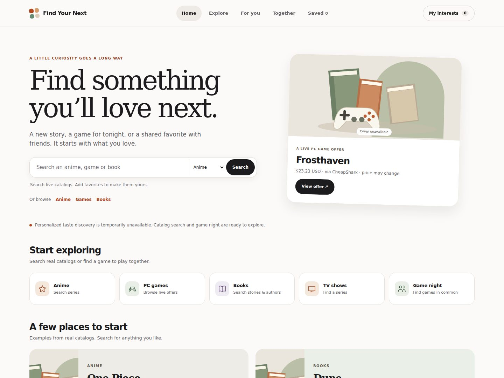
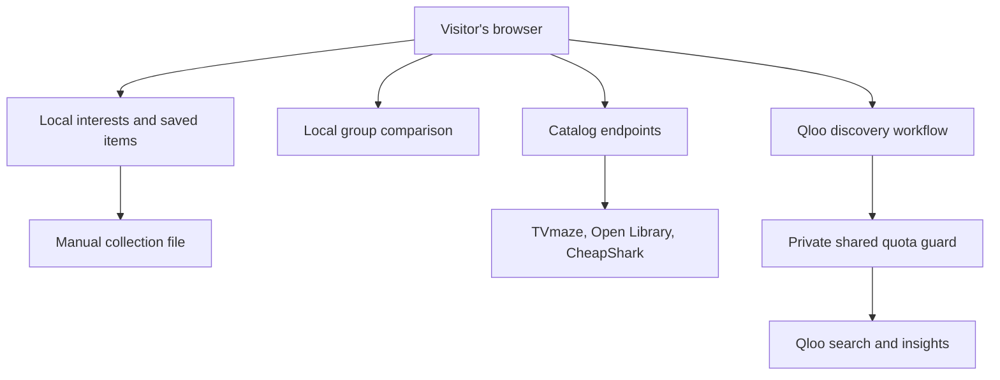

# Find Your Next


   

**Find something you’ll love next — or find common ground with friends.**

Search anime and TV, books and PC-game offers from named sources. Keep a collection of favorites, compare games your group already knows, and use Qloo to explore connections across categories.

[Open the application](https://find-your-next-qloo.vercel.app/) · [Testing report](docs/validation.md) · [Project story](docs/submission-draft.md)

**Team:** Adeel Falak Sher and Raouf Khalid.

**Status:** A bounded private-build check exercised real Qloo search and insights, including anime-to-games, group games, destinations and places. On production, one anime-to-games request succeeded, but later group and single-interest requests returned 503 from the quota guard. The guard's production reliability is unresolved; the live Qloo flow is not ready for judges. Real-device and screen-reader testing and user validation also remain outstanding; see the validation report for the precise scope of checks.

**Latest source:** The iOS-inspired refresh and collection search, sorting and grid/list views are tested locally and await deployment approval. The public website still serves the earlier release.



*Local browser preview, October 29, 2026, with Qloo disabled. The thumbnail above is project artwork, not a screenshot. Missing provider artwork uses a small code-generated SVG.*

## What works in the code

- Browse current PC game offers from CheapShark, including source links and prices in USD. Prices and availability may change.
- Search anime and TV shows through TVmaze and books through Open Library. Anime results are limited to shows TVmaze labels as Anime; coverage is not comprehensive.
- Add catalog titles or manually enter favorites from supported categories in a device-local interest profile; save and remove items. The latest source adds collection search, title sorting and persistent grid/list layout controls. Download a collection file and import it on another device: imports merge rather than erase existing items. This is manual transfer, not automatic sync.
- A four-slot instrument displays the number of interests selected for a Qloo query; it is not a taste score.
- Compare two to four people's entered game lists, ignoring differences in case and punctuation, and show the shortest playtime entered when everyone provides one. A separate group discovery action sends the first game entered for each person to Qloo as combined taste signals. It does not predict whether everyone will enjoy a suggestion. This does not compare calendars; users choose a time and check platform, ownership and game duration themselves.
- Choose a Qloo outcome for anime/TV, games, books, artists, brands, gifts, travel, creator discovery, venue or event planning. The adapter resolves exact, unambiguous entity names and uses TVmaze's premiere year when available to distinguish shows with the same name. It requests Qloo insights and shows named inputs only when Qloo returns per-interest explanation data.

Event and meetup pages provide prospective Qloo place or artist suggestions, not real event listings, dates or tickets. Gift suggestions are not verified product listings; game prices can be checked against CheapShark when a matching offer is returned. Creator suggestions do not verify willingness to collaborate. Travel results do not verify opening hours or reservations. No account, social network or automatic cross-device synchronization is implemented. Downloaded collections are unencrypted and exclude game-night entries.

## Data flow



Catalog results are not Qloo recommendations. The user's selected titles are sent to Qloo only when requesting taste discovery. Local interests, saved items and group entries remain in browser storage. Exported collection files contain interests and saved items, not group entries, and should be kept private. To limit abuse, the server stores keyed hashes of visitor IP addresses and request counts in a private quota record; old visitor counts are removed on a later successful request in a new hourly window. The host may maintain its own logs. Do not enter personal information as an interest.

## Run

Requires Node.js 22 or later. Install the locked dependencies before running:

```sh
npm ci
npm test
npm start
```

Open `http://127.0.0.1:3000`. Public catalog results require network access. The public Qloo route requires a private Vercel Blob store, its token, a secret salt and Vercel's trusted forwarded-IP header; leave it disabled in an ordinary local run. The server does not load `.env` files automatically.

For a bounded live provider check without enabling the public proxy, supply `QLOO_API_KEY` through a private environment and set `QLOO_VERIFY_LIVE=yes`, then run `npm run verify:qloo`. It makes one search and, if an exact match is found, one insights request. This consumes event quota. It prints only a count and sanitized errors, never the key; a failed exact match does not by itself establish that a key is invalid. Do not place the key in source code, command history or chat.

## Deployment and security

`vercel.json` configures static assets, serverless routes and security headers. The Qloo route fails closed without `QLOO_API_KEY`, `QLOO_PROXY_ENABLED=true`, `BLOB_READ_WRITE_TOKEN` and `RATE_LIMIT_SALT` (at least 32 characters). Use a private Blob store and a cryptographically random salt. The guard uses uncached reads and conditional writes to reserve at most one Qloo call per selected interest plus one insights call before starting a workflow. Defaults are 100 reserved calls per UTC day, 1,200 lifetime reserved calls and eight workflows per visitor per fixed UTC hour. The shared limits are application budgets, not a guarantee of the provider's remaining quota; calls from other applications are not counted. Failed or partial workflows do not refund reservations. Never put keys or tokens in browser code, screenshots or source control.

The API has fixed provider hosts, whitelisted entity types, bounded input and upstream timeouts. The quota guard reduces key exhaustion but does not prevent distributed denial of service; the free storage tier itself has limits. Catalog sources have their own rate limits; the small server-side cache is per instance and is not a global traffic control. Live event listings and shopping inventory require additional authorized providers.

## Sources and licenses

- Code: MIT, see [LICENSE](LICENSE).
- Isometric geometry uses the MIT-licensed Anatomy kit; see `scripts/vendor/ANATOMY-LICENSE` and [the figure notes](docs/anatomy.md).
- TVmaze anime/TV data: [TVmaze API](https://www.tvmaze.com/api), CC BY-SA. Results link back to TVmaze and retain attribution.
- Books and cover images: [Open Library](https://openlibrary.org/developers/api); user-triggered searches, no bulk data harvesting.
- PC prices and game offers: [CheapShark API](https://apidocs.cheapshark.com/); source links use its required redirect URL. Prices are USD and may change.
- Qloo data: [Qloo API](https://github.com/qloo/docs-public). The service and its content have their own terms.

Existing Qloo projects already cover gifts and game discovery, including [Taste Gifts](https://devpost.com/software/taste-gifts) and [MustPlay Scout](https://devpost.com/software/mustplay-scout). This app's shared-profile and group-workflow concept is a product hypothesis, not a claim of unique invention or measured impact.

## Tests and gaps

`npm test` exercises exact name resolution, year disambiguation, failed Qloo configuration, quota concurrency, catalog parsing, input validation, portable collection parsing, common-game matching, HTTP routes and a local redirect attack against a test key. `node scripts/load-check.mjs` sends a bounded 600-request load to a local process without calling providers.

For the optional browser checks, install Chrome or Chromium and install test-only tools without changing the lockfile (`npm install --no-save --no-package-lock --ignore-scripts playwright-core@1.58.2 axe-core@4.14.0`). Set `CHROME_PATH` to your browser executable if Playwright cannot find its own browser, then run `node scripts/check-ui.mjs`. The runner starts and stops a local server with Qloo disabled, then runs the interaction and accessibility suites. Both use controlled catalog responses. Set `FYN_BASE_URL` to another local test origin if needed; it must end in `/`. The accessibility script reports incomplete checks separately and returns a nonzero status for detected violations.

For an opt-in quota-consuming production smoke test, set `FYN_LIVE_TEST=yes` and run `node scripts/live-browser-check.cjs`. Browser emulation and automated accessibility tools are not substitutes for a real phone, VoiceOver, NVDA or a complete accessibility audit. See [the validation report](docs/validation.md) for scope and results. Tests do not establish comprehensive Qloo coverage, recommendation quality, accessibility compliance, suitability for minors, usability or competitive advantage.
